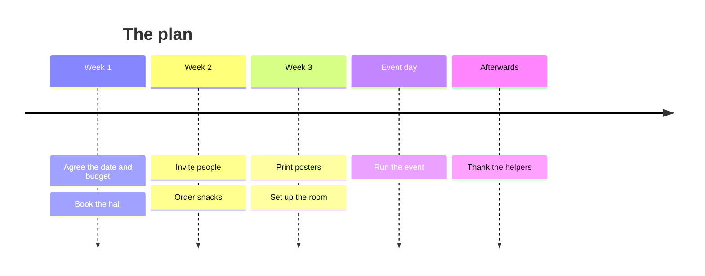

# Project board template

A starter for a small project, whether it is a school project, a club event or a home renovation: a board that shows tasks by stage, a place to jot down new tasks, a running log of what happened and a one-page plan. All the tasks and names in it are made up. Delete the pieces you do not need. Copy and edit the ones you do.

> [!module|tpl-project-board] Project board template

A board, a task inbox, a project log and a plan at a glance, each one a piece you can keep or delete.

Delete the pieces you do not need. Copy and edit the ones you do.

<!-- PIECE 1 of 4: The board. This is one separate piece of the template. You can delete it, or copy it and edit the copy (give every id in the copy a new name, including the ^board label under the data). The tasks are the rows in the data block below: change a task's stage, owner or due date by editing its row. -->

> [!activity|board icon:layout-grid] The board

Every task, grouped by stage. To move a task, change its stage in the rows under this piece.

```booklet query
from: board-rows
as: list
group: stage
fields: owner, due
```

```booklet data
{ "fields": { "label": "Task", "stage": "Stage", "badge": "Area", "owner": "Owner", "due": "Due", "note": "Note", "tone": "Tone" },
  "rows": [
    { "label": "Agree the date and the budget", "stage": "Done", "badge": "plan", "owner": "Sam", "due": "Mon", "tone": "good" },
    { "label": "Book the hall", "stage": "Done", "badge": "venue", "owner": "Priya", "due": "Tue", "tone": "good" },
    { "label": "Draft the invitation", "stage": "Doing", "badge": "words", "owner": "Priya", "due": "Thu", "note": "First draft is in the shared folder" },
    { "label": "Order the snacks", "stage": "Doing", "badge": "food", "owner": "Jo", "due": "Fri", "tone": "warn", "note": "Waiting on a price" },
    { "label": "Print the posters", "stage": "To do", "badge": "words", "owner": "Sam", "due": "Next Mon" },
    { "label": "Set up the chairs", "stage": "To do", "badge": "venue", "owner": "Jo", "due": "Next Fri" },
    { "label": "Thank the helpers", "stage": "To do", "badge": "people", "owner": "Priya", "due": "After" } ] }
```
^board-rows

<!-- PIECE 2 of 4: Task inbox. This is one separate piece of the template. You can delete it, or copy it and edit the copy (give every id in the copy a new name). -->

> [!activity|task-inbox repeat icon:inbox] Task inbox

Jot a task down the moment you think of it. When it is ready, add it to the board.

> [!tab|add] Add a task

> [!text|task] What needs doing?
> One short line.

> [!text|who] Who will do it?
> A name, or leave it blank.

> [!choice|stage] Where does it stand?
- [ ] To do
- [ ] Doing
- [ ] Done

> [!date|due] When is it due?

> [!tab|all-tasks] All tasks

Everything you have added, newest first.

```booklet query
from: task-inbox
as: list
label: task
badge: stage
fields: who, due
limit: 20
empty: No tasks yet. Add the first on the other tab.
```

<!-- PIECE 3 of 4: Project log. This is one separate piece of the template. You can delete it, or copy it and edit the copy (give every id in the copy a new name). -->

> [!activity|project-log repeat icon:notebook-pen] Project log

A line or two each time something happens: a decision, a blocker, a bit of progress.

> [!tab|write] Write an update

> [!text|what-happened] What happened?
> Short is fine.

> [!choice|kind open] What kind of update is it? Add your own.
- [ ] Progress
- [ ] Decision
- [ ] Blocker
- [ ] Note

> [!text|next-step] What is the next step?
> Leave blank if there is none.

> [!tab|log-so-far] The log

```booklet query
from: project-log
as: table
fields: kind, what-happened, next-step
limit: 15
empty: Nothing logged yet.
```

<!-- PIECE 4 of 4: Plan at a glance. This is one separate piece of the template. You can delete it, or copy it and edit the copy (give every id in the copy a new name, including the ^effort label under the data). -->

> [!activity|plan-glance icon:route] Plan at a glance

The main steps on one page, and where the effort goes. The figures are made up. Replace them with yours.



Hours of work by area (an estimate).

```booklet query
from: effort
as: bars
label: area
value: hours
```

```booklet data
[ { "area": "Venue", "hours": 6 },
  { "area": "Words", "hours": 8 },
  { "area": "Food", "hours": 4, "tone": "warn" },
  { "area": "People", "hours": 5, "tone": "good" } ]
```
^effort

> [!module|tpl-project-board end] End of Project board template
