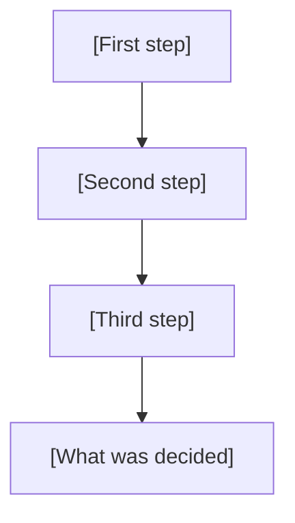

# Report

[One or two sentences: what this report is about, and who it is for.]

> [!module|report] Report

[One sentence on what the report covers.]

<!-- Piece: The answer -->

> [!activity|the-answer icon:flag] The answer

The answer first, then the figures behind it.

## The answer

[Your answer or recommendation, in one sentence.]

```booklet query
from: headline
as: tiles
```

```booklet data
[ { "label": "[What the first figure counts]", "value": "[figure]", "note": "[where it comes from]" },
  { "label": "[What the second figure counts]", "value": "[figure]" },
  { "label": "[What the third figure counts]", "value": "[figure]" } ]
```
^headline

<!-- Piece: The numbers -->

> [!activity|the-numbers icon:chart-column] The numbers

The figures in more detail.

## [What the chart shows]

[One sentence on what the chart compares.]

```booklet query
from: by-group
as: bars
label: group
value: amount
```

```booklet data
[ { "group": "[First group]", "amount": 3 },
  { "group": "[Second group]", "amount": 5 },
  { "group": "[Third group]", "amount": 2 } ]
```
^by-group

## How a figure is worked out

[Say in words how the figure is worked out.]

$$\text{[result]} = \text{[first amount]} \times \text{[second amount]}$$

[Then the figures put in, and anything the result assumes.]

<!-- Piece: How it was done -->

> [!activity|how-it-was-done icon:route] How it was done

[The steps of the work, in order.]



*In Obsidian, you may be asked once to allow diagrams in the vault. If the diagram shows as text, press Allow, then leave this activity and come back.*

> [!note] What was counted
> [What was measured or counted, and how.]

<!-- Piece: Your view -->

> [!activity|your-view icon:message-circle] Your view

A few questions to finish. Answer what you like and skip the rest.

> [!choice|decision] What would you do?
- [ ] Go ahead
- [ ] Go ahead, with changes
- [ ] Do not go ahead
- [ ] Not sure yet

> [!scale|confidence] How well do the figures support your choice?

1. Not much
2. Somewhat
3. Well
4. Very well

> [!text|more-info long] What else would you want to know before deciding?

<!-- End of pieces -->

> [!module|report end] End of Report
