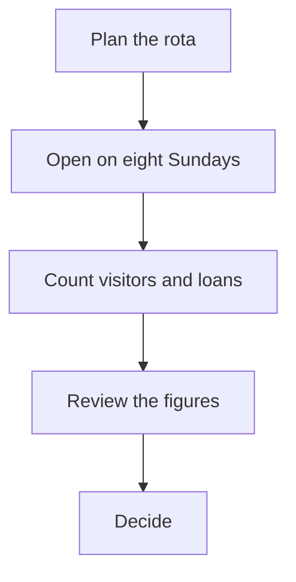

# Report or briefing template

A starter for a short report that people read rather than fill in: the answer first, a few headline numbers, one chart, one formula, one diagram and a few questions at the end. The sample report is about a made-up library trial, and every figure in it is invented. Replace the words and the numbers with yours. Delete the pieces you do not need. Copy and edit the ones you do.

> [!module|tpl-report-briefing] Report or briefing template

The answer, the numbers, a diagram and a few closing questions on a sample report, each one a piece you can keep or delete.

Delete the pieces you do not need. Copy and edit the ones you do.

To delete or copy a piece, open this file as text (in Obsidian, press the Show Markdown button; the browser app has no editor). Each piece starts at a comment that names it and runs to the next one.

- **Copying a piece:** copy it, give every id in the copy a new name, and change the question names in its queries to match (the `from:`, `fields:`, `label:`, `badge:` and `value:` lines), along with the label under any data block.
- **This first paragraph** is the card text shown in a module list. Edit it when you remove pieces.
- **Saving your own version:** give it a new module id (the id after the bar on the module line, and again on its end line) and a new `id:` in the front matter. Adding a module whose id already exists replaces the old one.

<!-- PIECE 1 of 4: The answer. This is one separate piece of the template. It only has words to read. You can delete it, or copy it and edit the copy (in the copy, rename every id, the names in its queries and the ^headline label under the data, as the top of the module says). The tiles are the rows in the data block: change the words and figures there. Write money and percentages as text, like "$420" or "62%". -->

> [!activity|the-answer icon:flag] Read the answer

The one-sentence answer, then the figures that back it up.

## The answer

Keep the library open on Sundays: the eight-week trial brought in steady visitors at a cost the budget can carry.

```booklet query
from: headline
as: tiles
```

```booklet data
[ { "label": "Visitors on an average Sunday", "value": 142, "note": "over eight Sundays", "tone": "good" },
  { "label": "Books borrowed per Sunday", "value": 310 },
  { "label": "Cost of one Sunday", "value": "$324", "note": "staff only" },
  { "label": "Visitors who were new", "value": "28%", "tone": "good" } ]
```
^headline

<!-- PIECE 2 of 4: The numbers. This is one separate piece of the template. You can delete it, or copy it and edit the copy (in the copy, rename every id, the names in its queries and the ^by-hour label under the data, as the top of the module says). The chart is drawn from the data block: change the rows there. The page adds nothing up, so write each figure in already worked out. -->

> [!activity|the-numbers icon:chart-column] See the numbers

Where the visitors came and what a Sunday costs. All figures are invented for the sample.

## When people came

Average visitors in each hour of an opening day.

```booklet query
from: by-hour
as: bars
label: hour
value: visitors
```

```booklet data
[ { "hour": "10 to 11", "visitors": 18 },
  { "hour": "11 to 12", "visitors": 34 },
  { "hour": "12 to 1", "visitors": 41, "tone": "good" },
  { "hour": "1 to 2", "visitors": 27 },
  { "hour": "2 to 3", "visitors": 15 },
  { "hour": "3 to 4", "visitors": 7, "tone": "warn" } ]
```
^by-hour

## What a Sunday costs

The cost is the number of staff, times the hours open, times the hourly rate:

$$\text{cost of a Sunday} = \text{staff} \times \text{hours open} \times \text{hourly rate}$$

With 3 staff, 6 hours and a rate of 18 dollars an hour, that is $3 \times 6 \times 18 = 324$ dollars. This assumes the same three people every Sunday and no extra cleaning.

<!-- PIECE 3 of 4: How it works. This is one separate piece of the template. It only has words to read. You can delete it, or copy it and edit the copy (in the copy, rename every id and the names in its queries, as the top of the module says). The diagram is a mermaid block: edit the words inside the boxes. -->

> [!activity|how-it-works icon:route] See how the trial worked

The steps of the trial, in order.



*In Obsidian, you may be asked once to allow diagrams in the vault. If the diagram shows as text, press Allow, then leave this activity and come back.*

> [!note] What was counted
> At the door, a volunteer tallied each visitor by the hour. At the desk, staff noted each book borrowed. Nothing else was recorded.

<!-- PIECE 4 of 4: Your view. This is one separate piece of the template. You can delete it, or copy it and edit the copy (in the copy, rename every id and the names in its queries, as the top of the module says). -->

> [!activity|your-view icon:message-circle] Give your view

A few questions to finish. Answer what you like and skip the rest.

> [!choice|decision] What would you do?
- [ ] Open every Sunday
- [ ] Open on some Sundays
- [ ] Go back to six days a week
- [ ] Not sure yet

> [!scale|confidence] How well do the figures support your choice?

1. Not much
2. Somewhat
3. Well
4. Very well

> [!text|more-info long] What else would you want to know before deciding?

<!-- END OF PIECES. Keep the module end line below. -->

> [!module|tpl-report-briefing end] End of Report or briefing template
