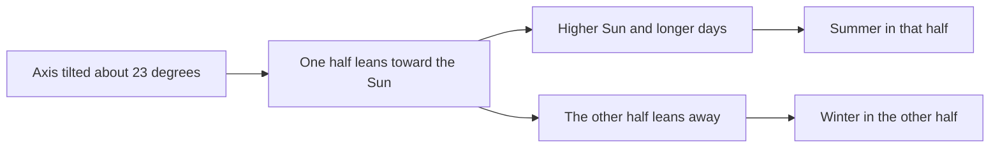

# Study guide template

A starter study guide for a student, a teacher or a curious person: a short reading, a few flashcards, a quiz that tells you straight away whether you were right, and a log of your study sessions. The topic (why we have seasons) is only a sample. Swap in your own. Delete the pieces you do not need. Copy and edit the ones you do.

> [!module|tpl-study-guide] Study guide template

A reading, flashcards, a quiz and a study log on a sample topic, each one a piece you can keep or delete.

Delete the pieces you do not need. Copy and edit the ones you do.

<!-- PIECE 1 of 4: The reading. This is one separate piece of the template. It only has words to read. You can delete it, or copy it and edit the copy (give every id in the copy a new name). Replace the sample topic with your own. -->

> [!activity|reading icon:book-open] Read: why we have seasons

Read this once, then try the flashcards and the quiz. It takes about five minutes.

## The short version

Seasons happen because the Earth's axis is tilted, not because the Earth moves closer to or further from the Sun.

## What the tilt does

The Earth spins on an axis that leans about 23 degrees from straight up. As the Earth goes around the Sun over a year, that lean always points the same way in space. So for part of the year the northern half leans toward the Sun, and for part of the year it leans away.

When a hemisphere leans toward the Sun:

- The Sun climbs higher in the sky, so its light arrives more directly.
- Days are longer, so there are more hours of sunshine.
- Together, these make it summer there.

At the same time the other hemisphere leans away, so it is winter there.



> [!note] Four days worth knowing
> The two **solstices** are the longest and shortest days of the year. The two **equinoxes** fall between them, when day and night are close to equal everywhere.

<!-- PIECE 2 of 4: Flashcards. This is one separate piece of the template. It only has words to read. You can delete it, or copy it and edit the copy (give every id in the copy a new name). Each card is one folded note: the term is the title and the answer is inside. -->

> [!activity|flashcards icon:layers] Flashcards

Say the answer out loud first, then open the card to check.

> [!note]- Axis
> The imaginary line the Earth spins around. It leans about 23 degrees.

> [!note]- Solstice
> The day of the year with the most daylight (summer) or the least (winter) in a hemisphere.

> [!note]- Equinox
> A day when day and night are close to equal everywhere. It happens twice a year.

> [!note]- Hemisphere
> One half of the Earth. The northern and southern halves have opposite seasons.

> [!note]- Season
> A part of the year with its own typical weather and day length, caused by the tilt of the axis.

<!-- PIECE 3 of 4: Quiz. This is one separate piece of the template. You can delete it, or copy it and edit the copy (give every id in the copy a new name). In a pick-one or pick-any question, the correct option is marked with [x]. The reader sees at once whether they were right. Nothing is scored or stored. -->

> [!activity|quiz icon:circle-help] Quiz: check yourself

Four questions. Pick an answer and you will see straight away whether it was right. Nothing is scored.

> [!choice|cause] What mainly causes the seasons?
- [ ] The Earth being closer to the Sun in summer
  - Not quite. The Earth is actually a little closer to the Sun in early January.
- [x] The tilt of the Earth's axis
  - Yes. The tilt changes how directly sunlight arrives and how long the days are.
- [ ] The Moon's pull
  - Not quite. The Moon causes tides, not seasons.

> [!hint]- Hint
> Think about which half of the Earth is leaning toward the Sun.

> [!solution]- Why
> The axis is tilted about 23 degrees. As the Earth travels around the Sun, each half in turn leans toward it, which gives that half longer days and higher sunlight.

> [!multi|true-facts] Which of these are true? Pick every one.
- [x] When it is summer in the north, it is winter in the south
- [ ] Summer happens when the whole Earth is nearest the Sun
- [x] Days are longest near the summer solstice
- [ ] The equinox is the hottest day of the year

> [!solution]- Why
> The two halves of the Earth have opposite seasons, and the longest day comes at the summer solstice. Distance from the Sun does not set the seasons, and an equinox is simply a day of near-equal day and night.

> [!choice|equinox] On an equinox, day and night are...
- [ ] Longest in the north
- [x] Close to equal everywhere
- [ ] Longest in the south

> [!text|own-words long] In your own words: why is it summer in the south when it is winter in the north?
> Two or three sentences. There is no right wording.

> [!solution]- A sample answer
> The Earth is tilted. When the northern half leans away from the Sun, it gets less direct light and shorter days, while the southern half leans toward the Sun and gets more.

<!-- PIECE 4 of 4: Study log. This is one separate piece of the template. You can delete it, or copy it and edit the copy (give every id in the copy a new name). -->

> [!activity|study-log repeat icon:clipboard-list] Study log

Add a line each time you study. It helps to see how much you have done.

> [!tab|log] Log a session

> [!text|studied] What did you study?
> A topic or a chapter.

> [!number|minutes min:0 max:600 step:5] How many minutes?

> [!scale|confidence] How well do you know it now?

1. Not yet
2. A little
3. Mostly
4. Well

> [!text|next-time] What to look at next time?
> Leave blank if nothing.

> [!tab|history] Progress

Your confidence over your sessions.

```booklet query
from: study-log
as: line
label: date
fields: confidence
limit: 14
empty: Nothing to draw yet. Log a session first.
```

```booklet query
from: study-log
as: list
label: studied
value: minutes
limit: 10
empty: No sessions yet.
```

> [!module|tpl-study-guide end] End of Study guide template
