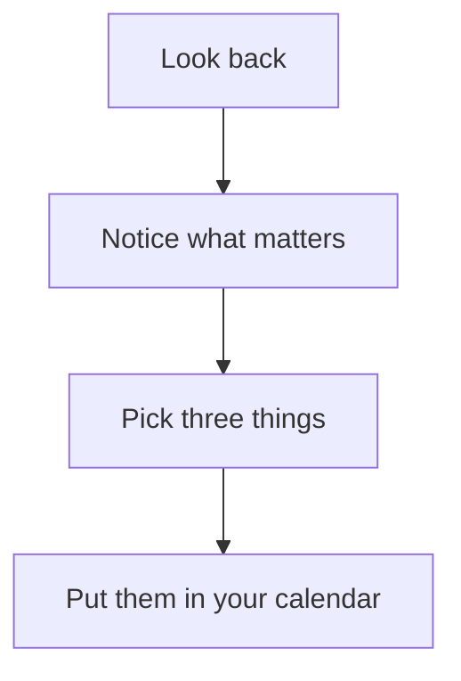

# Weekly review

Fifteen minutes once a week: look back at what happened, choose what matters next week, and keep a few numbers so you can see the weeks side by side.

> [!module|weekly-review] Weekly review

A look back, a plan for next week, the numbers you count and a short guide.

<!-- Piece: Look back at the week -->

> [!activity|look-back repeat icon:rotate-ccw] Look back at the week

Ten minutes, once a week. Answer what you like and skip the rest.

> [!tab|review] Review

> [!lines|finished] What did I finish?
> One line each. Small things count.

> [!text|went-well long] What went well?
> Say what, and what helped it.

> [!text|was-hard long] What was hard or got stuck?
> No blame. Just what happened.

> [!choice|pace] How did the pace feel?
- [ ] Too slow
- [ ] About right
- [ ] Too fast

> [!text|learned] What did I learn?
> A sentence is enough.

> [!tab|earlier] Earlier weeks

The last few reviews, newest first.

```booklet query
from: look-back
as: cards
fields: finished, went-well, was-hard
limit: 4
empty: No reviews yet.
```

<!-- Piece: Plan the next week -->

> [!activity|plan-ahead repeat icon:target] Plan the next week

Choose a few things and leave the rest. Three is plenty.

> [!tab|plan] Plan

> [!lines|top-three] My top three for next week
> One line each.

> [!text|in-the-way] What could get in the way?
> And what you might do about it.

> [!choice|focus-day] Which day will I protect for focused work?
- [ ] Monday
- [ ] Tuesday
- [ ] Wednesday
- [ ] Thursday
- [ ] Friday

> [!text|dont-forget long] Anything I should not forget?

> [!tab|past-plans] Past plans

```booklet query
from: plan-ahead
as: list
label: focus-day
fields: top-three
limit: 6
empty: No plans yet.
```

<!-- Piece: Weekly numbers -->

> [!activity|weekly-numbers repeat icon:chart-line] Weekly numbers

A few things to count each week. Estimates are fine: the point is to see them change.

> [!tab|count] This week

Add the things you want to count, such as hours of focused work, tasks finished or evenings kept free, and put in this week's number for each. Rename one, or remove one you no longer need.

```booklet query
from: counts
as: table
fields: what, this-week
add
delete
empty: Nothing to count yet. Add the first thing.
```

> [!number|this-week each:counts min:0] This week

```booklet data
{ "fields": { "what": { "label": "What I count", "edit": "text" } },
  "idFormat": "count-{n}",
  "rows": [] }
```
^counts

> [!tab|trend] Trend

Each count, week by week.

```booklet query
from: weekly-numbers
as: line
label: date
fields: this-week
limit: 12
empty: Nothing to draw yet. Add a week first.
```

The same numbers in a table.

```booklet query
from: weekly-numbers
as: table
fields: this-week
limit: 8
empty: No weeks yet.
```

<!-- Piece: How to run a review -->

> [!activity|how-to icon:book-open] How to run a review in 15 minutes

A simple order that works. Most people do it on Friday afternoon or Sunday evening.



*In Obsidian, you may be asked once to allow diagrams in the vault. If the diagram shows as text, press Allow, then leave this activity and come back.*

1. **Look back (5 minutes).** Skim your calendar and your notes. What happened?
2. **Notice (3 minutes).** What do you want more of? What do you want less of?
3. **Choose (4 minutes).** Pick no more than three things for next week.
4. **Place (3 minutes).** Put them in your calendar, so they get a time.

> [!tip] Keep it small
> A review that takes five minutes and happens every week beats a perfect one you skip.

<!-- End of pieces -->

> [!module|weekly-review end] End of Weekly review
