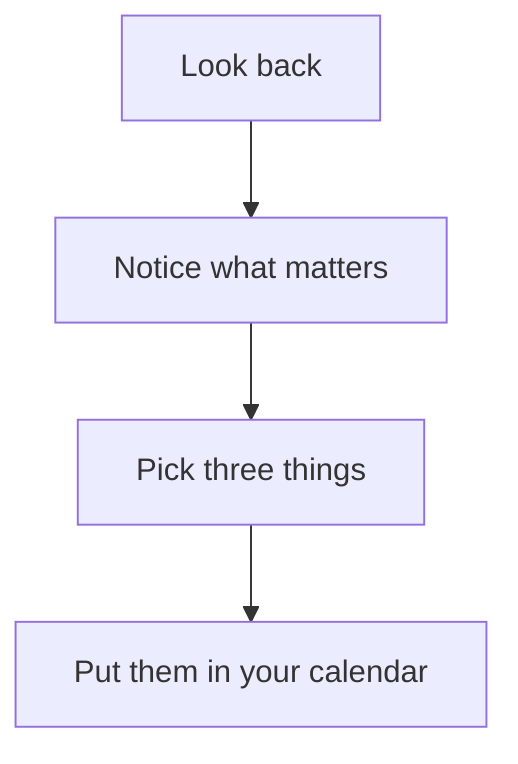

# Weekly review template

A starter for a fifteen-minute review once a week: look back at what happened, choose what matters next week, and keep a few simple numbers so you can see the weeks side by side. The questions are only samples. Rewrite them to fit your own work or home life. Delete the pieces you do not need. Copy and edit the ones you do.

> [!module|tpl-weekly-review] Weekly review template

A look back, a plan for next week, some weekly numbers and a short guide, each one a piece you can keep or delete.

Delete the pieces you do not need. Copy and edit the ones you do.

To delete or copy a piece, open this file as text (in Obsidian, press the Show Markdown button; the browser app has no editor). Each piece starts at a comment that names it and runs to the next one.

- **Copying a piece:** copy it, give every id in the copy a new name, and change the question names in its queries to match (the `from:`, `fields:`, `label:`, `badge:` and `value:` lines), along with the label under any data block.
- **This first paragraph** is the card text shown in a module list. Edit it when you remove pieces.
- **Saving your own version:** give it a new module id (the id after the bar on the module line, and again on its end line) and a new `id:` in the front matter. Adding a module whose id already exists replaces the old one.

<!-- PIECE 1 of 4: Look back at the week. This is one separate piece of the template. You can delete it, or copy it and edit the copy (in the copy, rename every id and the names in its queries, as the top of the module says). -->

> [!activity|look-back repeat icon:rotate-ccw] Look back at the week

Ten minutes, once a week. Answer what you like and skip the rest.

> [!tab|review] Review

> [!lines|finished] What did I finish?
> One line each. Small things count.

> [!text|went-well long] What went well?
> Say what, and what helped it.

> [!text|was-hard long] What was hard or got stuck?
> No blame. Just what happened.

> [!choice|pace] How did the pace feel?
- [ ] Too slow
- [ ] About right
- [ ] Too fast

> [!text|learned] What did I learn?
> A sentence is enough.

> [!tab|earlier] Earlier weeks

The last few reviews, newest first.

```booklet query
from: look-back
as: cards
fields: finished, went-well, was-hard
limit: 4
empty: No reviews yet.
```

<!-- PIECE 2 of 4: Plan the next week. This is one separate piece of the template. You can delete it, or copy it and edit the copy (in the copy, rename every id and the names in its queries, as the top of the module says). -->

> [!activity|plan-ahead repeat icon:target] Plan the next week

Choose a few things and leave the rest. Three is plenty.

> [!tab|plan] Plan

> [!lines|top-three] My top three for next week
> One line each.

> [!text|in-the-way] What could get in the way?
> And what you might do about it.

> [!choice|focus-day] Which day will I protect for focused work?
- [ ] Monday
- [ ] Tuesday
- [ ] Wednesday
- [ ] Thursday
- [ ] Friday

> [!text|dont-forget long] Anything I should not forget?

> [!tab|past-plans] Past plans

```booklet query
from: plan-ahead
as: list
label: focus-day
fields: top-three
limit: 6
empty: No plans yet.
```

<!-- PIECE 3 of 4: Weekly numbers. This is one separate piece of the template. You can delete it, or copy it and edit the copy (in the copy, rename every id and the names in its queries, as the top of the module says). Change the number questions to whatever you want to count. -->

> [!activity|weekly-numbers repeat icon:chart-line] Weekly numbers

Three counts for the week. Estimates are fine. The point is to see them change.

> [!tab|count] Count

> [!number|focus-hours min:0 max:100] Hours of focused work

> [!number|tasks-done min:0 max:500] Tasks finished

> [!number|free-evenings min:0 max:7] Evenings kept free

> [!tab|trend] Trend

Hours of focused work, week by week.

```booklet query
from: weekly-numbers
as: line
label: date
fields: focus-hours
limit: 12
empty: Nothing to draw yet. Add a week first.
```

Tasks finished, week by week.

```booklet query
from: weekly-numbers
as: line
label: date
fields: tasks-done
limit: 12
empty: Nothing to draw yet. Add a week first.
```

Evenings kept free, week by week.

```booklet query
from: weekly-numbers
as: line
label: date
fields: free-evenings
limit: 12
empty: Nothing to draw yet. Add a week first.
```

All three in one table.

```booklet query
from: weekly-numbers
as: table
fields: focus-hours, tasks-done, free-evenings
limit: 8
```

<!-- PIECE 4 of 4: How to run a review. This is one separate piece of the template. It only has words to read. You can delete it, or copy it and edit the copy (in the copy, rename every id and the names in its queries, as the top of the module says). -->

> [!activity|how-to icon:book-open] How to run a review in 15 minutes

A simple order that works. Most people do it on Friday afternoon or Sunday evening.



*In Obsidian, you may be asked once to allow diagrams in the vault. If the diagram shows as text, press Allow, then leave this activity and come back.*

1. **Look back (5 minutes).** Skim your calendar and your notes. What happened?
2. **Notice (3 minutes).** What do you want more of? What do you want less of?
3. **Choose (4 minutes).** Pick no more than three things for next week.
4. **Place (3 minutes).** Put them in your calendar, so they get a time.

> [!tip] Keep it small
> A review that takes five minutes and happens every week beats a perfect one you skip.

<!-- END OF PIECES. Keep the module end line below. -->

> [!module|tpl-weekly-review end] End of Weekly review template
